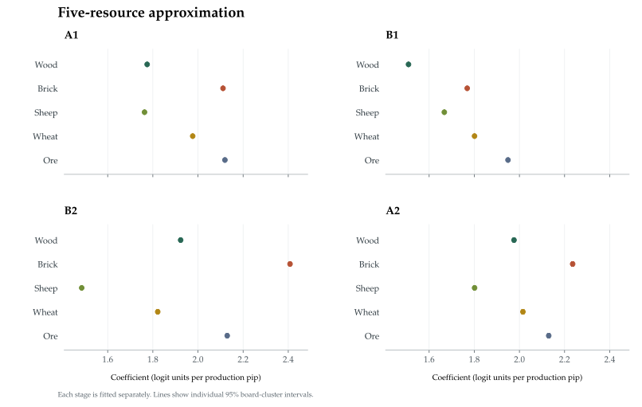
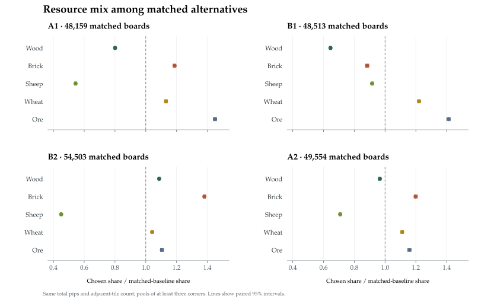
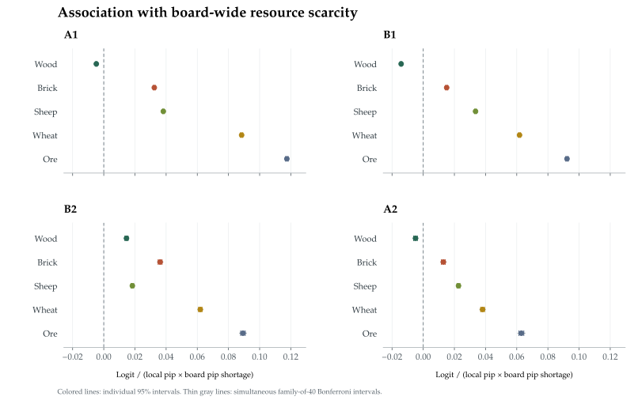

# Generation 37 opening preferences

100,000 boards · 80,000 fitting / 20,000 held out · 400,000 settlement decisions · A1 → B1 → B2 → A2

Generation 37, the final generation in this training run, chooses one opening sequence per generated board using its highest-scoring legal move. The analyses below describe those network preferences. They use no search or completed-game outcomes, and do not estimate the winning value of a resource.

[Markdown report](RESULTS.md) · [Analysis data](results.json) · [Methods and downloads](#methods-and-downloads)

## The measured patterns

- Total pips alone give held-out R² of 0.856 / 0.860 for the first settlements and 0.682 / 0.676 for the second settlements.
- Largest chosen-share enrichment within the matched pools: A1: ore (1.45×); B1: ore (1.41×); B2: brick (1.38×); A2: brick (1.20×). These are descriptive ratios, not a universal resource ranking.
- Adding board-supply interactions changes held-out R² by +0.0016 to +0.0096, depending on placement stage. The detailed intervals and the separate legal-availability model appear below.

## How well do simple features reproduce the scores?

A row of data is a legal settlement candidate. Scores and predictors are centered within each decision. R² = 1 − fitted mean squared error / equal-score mean squared error, with errors averaged first over candidates and then equally over boards. It measures relative-score fidelity, not the fraction of moves predicted correctly.

| Regression inputs | A1 | B1 | B2 | A2 |
| --- | ---: | ---: | ---: | ---: |
| Total pips (one shared weight) | 0.856 | 0.860 | 0.682 | 0.676 |
| Five resource pip counts | 0.869 | 0.874 | 0.724 | 0.685 |
| + Coverage, concentration, adjacent tiles | 0.874 | 0.880 | 0.834 | 0.838 |
| + Port features | 0.887 | 0.903 | 0.843 | 0.849 |
| + Dice-number features | 0.924 | 0.914 | 0.860 | 0.863 |
| + Expansion and settlement proximity | 0.924 | 0.920 | 0.864 | 0.873 |
| + Resource-specific context | 0.927 | 0.924 | 0.869 | 0.878 |
| + Board-supply interactions | 0.937 | 0.931 | 0.873 | 0.879 |
| + Legal-availability interactions (alternative) | 0.937 | 0.931 | 0.871 | 0.878 |

The rows from five resource pip counts through resource-specific context add features cumulatively. The last two rows each add a different availability measure to that same context model; they are alternatives. Dice-number features include production variance, a nonlinear function of total production, so their gain cannot be assigned solely to diversification.

Choice agreement and held-out uncertainty

| Stage | Model | R² [95% CI] | Exact top-choice agreement |
| --- | ---: | ---: | ---: |
| A1 | Five resource pip counts | 0.869 [0.868, 0.869] | 53.2% |
| A1 | + Expansion and settlement proximity | 0.924 [0.924, 0.925] | 58.7% |
| A1 | + Resource-specific context | 0.927 [0.927, 0.928] | 58.3% |
| B1 | Five resource pip counts | 0.874 [0.874, 0.875] | 42.6% |
| B1 | + Expansion and settlement proximity | 0.920 [0.919, 0.920] | 41.3% |
| B1 | + Resource-specific context | 0.924 [0.923, 0.924] | 41.5% |
| B2 | Five resource pip counts | 0.724 [0.723, 0.725] | 36.3% |
| B2 | + Expansion and settlement proximity | 0.864 [0.864, 0.865] | 55.4% |
| B2 | + Resource-specific context | 0.869 [0.869, 0.870] | 55.4% |
| A2 | Five resource pip counts | 0.685 [0.684, 0.686] | 27.5% |
| A2 | + Expansion and settlement proximity | 0.873 [0.872, 0.874] | 57.4% |
| A2 | + Resource-specific context | 0.878 [0.877, 0.878] | 57.6% |

A model can reproduce the broad score differences while missing close choices between the best corners. Test intervals use whole-board delta-method uncertainty conditional on the fitted regressions.

## Each resource alone, then all five together

Each cell in the first table fits only that resource’s local pip count. These one-feature R² values do not add up to the joint fit and do not isolate resource importance.

| Placement | Wood | Brick | Sheep | Wheat | Ore |
| --- | ---: | ---: | ---: | ---: | ---: |
| A1 | 0.065 | 0.102 | 0.062 | 0.108 | 0.104 |
| B1 | 0.053 | 0.071 | 0.097 | 0.108 | 0.097 |
| B2 | 0.090 | 0.141 | 0.019 | 0.050 | 0.065 |
| A2 | 0.069 | 0.068 | 0.063 | 0.058 | 0.048 |

The joint model fits five pip coefficients at once. The following values are logit units per pip in that approximation, with individual 95% intervals. They are not the neural network’s stored weights. Compare resources within one stage and specification; later stages also have different score scales and opening histories.

[SVG](resource-coefficients.svg) · [PNG](resource-coefficients.png)

| Placement | Wood | Brick | Sheep | Wheat | Ore |
| --- | ---: | ---: | ---: | ---: | ---: |
| A1 | +1.775 [1.773, 1.776] | +2.111 [2.109, 2.112] | +1.763 [1.762, 1.765] | +1.977 [1.974, 1.979] | +2.119 [2.117, 2.122] |
| B1 | +1.509 [1.507, 1.510] | +1.769 [1.767, 1.770] | +1.667 [1.666, 1.669] | +1.801 [1.799, 1.803] | +1.949 [1.947, 1.952] |
| B2 | +1.923 [1.919, 1.927] | +2.408 [2.404, 2.412] | +1.485 [1.482, 1.488] | +1.822 [1.817, 1.826] | +2.130 [2.125, 2.134] |
| A2 | +1.976 [1.971, 1.981] | +2.236 [2.231, 2.241] | +1.801 [1.798, 1.805] | +2.015 [2.010, 2.021] | +2.130 [2.124, 2.135] |

Pairwise resource substitutions and multiplicity

The following contrast replaces one pip of one resource with one pip of another inside the fitted five-resource equation. It does not assert that a valid board intervention could hold all other strategic properties fixed. Simultaneous intervals use Bonferroni adjustment over the 40 stage-specific pairwise contrasts.

| Stage | Replace → add | Logit difference [95% CI] | Family-of-40 interval |
| --- | ---: | ---: | ---: |
| A1 | Wood → Brick | +0.336 [0.334, 0.338] | [0.333, 0.339] |
| A1 | Wood → Sheep | −0.012 [−0.013, −0.010] | [−0.014, −0.009] |
| A1 | Brick → Sheep | −0.348 [−0.350, −0.346] | [−0.351, −0.345] |
| A1 | Wood → Wheat | +0.202 [0.200, 0.204] | [0.198, 0.205] |
| A1 | Brick → Wheat | −0.134 [−0.137, −0.132] | [−0.138, −0.130] |
| A1 | Sheep → Wheat | +0.213 [0.211, 0.216] | [0.210, 0.217] |
| A1 | Wood → Ore | +0.345 [0.342, 0.347] | [0.341, 0.349] |
| A1 | Brick → Ore | +0.008 [0.006, 0.011] | [0.004, 0.013] |
| A1 | Sheep → Ore | +0.356 [0.353, 0.359] | [0.352, 0.361] |
| A1 | Wheat → Ore | +0.143 [0.139, 0.146] | [0.137, 0.149] |
| B1 | Wood → Brick | +0.260 [0.258, 0.262] | [0.257, 0.263] |
| B1 | Wood → Sheep | +0.159 [0.157, 0.161] | [0.156, 0.162] |
| B1 | Brick → Sheep | −0.101 [−0.104, −0.099] | [−0.105, −0.098] |
| B1 | Wood → Wheat | +0.293 [0.290, 0.295] | [0.289, 0.296] |
| B1 | Brick → Wheat | +0.032 [0.030, 0.035] | [0.029, 0.036] |
| B1 | Sheep → Wheat | +0.134 [0.131, 0.136] | [0.130, 0.138] |
| B1 | Wood → Ore | +0.441 [0.438, 0.443] | [0.437, 0.445] |
| B1 | Brick → Ore | +0.181 [0.178, 0.183] | [0.176, 0.185] |
| B1 | Sheep → Ore | +0.282 [0.279, 0.285] | [0.278, 0.287] |
| B1 | Wheat → Ore | +0.148 [0.145, 0.152] | [0.143, 0.154] |
| B2 | Wood → Brick | +0.485 [0.478, 0.491] | [0.474, 0.495] |
| B2 | Wood → Sheep | −0.438 [−0.443, −0.434] | [−0.446, −0.431] |
| B2 | Brick → Sheep | −0.923 [−0.928, −0.918] | [−0.932, −0.914] |
| B2 | Wood → Wheat | −0.102 [−0.107, −0.096] | [−0.110, −0.093] |
| B2 | Brick → Wheat | −0.586 [−0.592, −0.580] | [−0.596, −0.576] |
| B2 | Sheep → Wheat | +0.337 [0.331, 0.342] | [0.328, 0.346] |
| B2 | Wood → Ore | +0.206 [0.201, 0.212] | [0.198, 0.215] |
| B2 | Brick → Ore | −0.278 [−0.284, −0.272] | [−0.288, −0.268] |
| B2 | Sheep → Ore | +0.645 [0.639, 0.650] | [0.636, 0.653] |
| B2 | Wheat → Ore | +0.308 [0.301, 0.315] | [0.296, 0.319] |
| A2 | Wood → Brick | +0.260 [0.252, 0.267] | [0.247, 0.272] |
| A2 | Wood → Sheep | −0.175 [−0.180, −0.169] | [−0.184, −0.166] |
| A2 | Brick → Sheep | −0.434 [−0.441, −0.428] | [−0.445, −0.424] |
| A2 | Wood → Wheat | +0.039 [0.033, 0.046] | [0.029, 0.050] |
| A2 | Brick → Wheat | −0.220 [−0.228, −0.213] | [−0.233, −0.208] |
| A2 | Sheep → Wheat | +0.214 [0.207, 0.221] | [0.203, 0.226] |
| A2 | Wood → Ore | +0.154 [0.147, 0.160] | [0.143, 0.164] |
| A2 | Brick → Ore | −0.106 [−0.113, −0.099] | [−0.118, −0.094] |
| A2 | Sheep → Ore | +0.328 [0.322, 0.335] | [0.318, 0.339] |
| A2 | Wheat → Ore | +0.114 [0.106, 0.123] | [0.100, 0.129] |

## What is selected when production and geometry match?

For each chosen settlement, compare its resource fractions with a uniformly selected legal corner having the same total pips and adjacent-tile count. The pool includes the chosen corner; retain a board only when at least three corners match. This conditions on the production level the network chose and covers the reported subset, rather than every opening.

Enrichment is the mean chosen resource fraction divided by the mean matched-baseline fraction, giving every eligible board equal weight. A ratio of 1.10 means a 10% larger average share of that resource’s pips; it does not mean the bot is 10% more likely to win or to select any particular corner.

| Placement | Eligible / all boards | Coverage | Matching pool: median (IQR) |
| --- | ---: | ---: | ---: |
| A1 | 48,159 / 100,000 | 48.2% | 4 (3–5) |
| B1 | 48,513 / 100,000 | 48.5% | 4 (3–5) |
| B2 | 54,503 / 100,000 | 54.5% | 4 (3–5) |
| A2 | 49,554 / 100,000 | 49.6% | 4 (3–4) |

[SVG](matched-resource-enrichment.svg) · [PNG](matched-resource-enrichment.png)

| Placement | Wood ratio [95% CI] | Brick ratio [95% CI] | Sheep ratio [95% CI] | Wheat ratio [95% CI] | Ore ratio [95% CI] |
| --- | ---: | ---: | ---: | ---: | ---: |
| A1 | 0.801 [0.794, 0.808] | 1.187 [1.178, 1.196] | 0.544 [0.538, 0.550] | 1.131 [1.123, 1.140] | 1.450 [1.439, 1.460] |
| B1 | 0.645 [0.638, 0.653] | 0.884 [0.874, 0.894] | 0.916 [0.909, 0.922] | 1.220 [1.212, 1.229] | 1.412 [1.401, 1.423] |
| B2 | 1.087 [1.081, 1.093] | 1.381 [1.373, 1.389] | 0.450 [0.445, 0.456] | 1.042 [1.035, 1.049] | 1.105 [1.096, 1.115] |
| A2 | 0.966 [0.959, 0.973] | 1.199 [1.189, 1.209] | 0.708 [0.702, 0.714] | 1.111 [1.103, 1.119] | 1.158 [1.148, 1.169] |

Already-owned versus missing resources, within matched pools

| Stage | Resource | Missing: boards | Missing: ratio [CI] | Owned: boards | Owned: ratio [CI] |
| --- | ---: | ---: | ---: | ---: | ---: |
| B2 | Wood | 31,933 | 1.181 [1.174, 1.188] | 22,570 | 0.933 [0.923, 0.943] |
| B2 | Brick | 36,161 | 1.508 [1.499, 1.517] | 18,342 | 1.054 [1.039, 1.069] |
| B2 | Sheep | 18,759 | 0.727 [0.718, 0.737] | 35,744 | 0.267 [0.261, 0.273] |
| B2 | Wheat | 21,310 | 1.314 [1.304, 1.324] | 33,193 | 0.814 [0.805, 0.823] |
| B2 | Ore | 25,877 | 1.397 [1.384, 1.410] | 28,626 | 0.739 [0.726, 0.752] |
| A2 | Wood | 23,415 | 1.198 [1.188, 1.208] | 26,139 | 0.715 [0.705, 0.726] |
| A2 | Brick | 23,202 | 1.615 [1.602, 1.628] | 26,352 | 0.673 [0.660, 0.686] |
| A2 | Sheep | 28,784 | 0.923 [0.915, 0.931] | 20,770 | 0.323 [0.315, 0.332] |
| A2 | Wheat | 16,632 | 1.492 [1.481, 1.504] | 32,922 | 0.816 [0.806, 0.826] |
| A2 | Ore | 18,063 | 1.574 [1.559, 1.589] | 31,491 | 0.763 [0.751, 0.777] |

These subgroups condition on the first settlement chosen by the same network. They describe conditional preferences and do not hold the rest of the position fixed.

Comparison against all positive-production legal corners

| Placement | Wood | Brick | Sheep | Wheat | Ore |
| --- | ---: | ---: | ---: | ---: | ---: |
| A1 | 0.831 [0.825, 0.836] | 1.168 [1.160, 1.175] | 0.590 [0.585, 0.595] | 1.133 [1.127, 1.139] | 1.428 [1.420, 1.435] |
| B1 | 0.753 [0.746, 0.759] | 0.804 [0.796, 0.812] | 1.046 [1.040, 1.052] | 1.174 [1.167, 1.180] | 1.243 [1.235, 1.251] |
| B2 | 1.199 [1.194, 1.204] | 1.486 [1.479, 1.493] | 0.471 [0.467, 0.476] | 0.984 [0.979, 0.990] | 0.978 [0.970, 0.986] |
| A2 | 1.008 [1.002, 1.015] | 1.118 [1.110, 1.126] | 0.807 [0.801, 0.812] | 1.081 [1.074, 1.087] | 1.043 [1.035, 1.052] |

This broader baseline includes differences in total production and coastal geometry. Zero-pip corners are excluded because their resource fractions are undefined. These descriptive calculations use all generated boards, including the fitting set; they do not fit another predictive model.

## Does scarcity change the fitted resource preference?

The context model controls for the listed production, coverage, concentration, port, number-pattern, expansion, and proximity features. It also includes resource-specific interactions with existing production, missing access, matching owned ports, geometric port access, and starting-card counts. Two separate extensions then test board supply or the resources remaining among legal corners.

- Board supply: candidate resource pips × (reference board supply − actual board supply). The reference is 58 × that resource’s tile count / 18; there are 58 pips across the 18 producing tiles.
- Legal availability: candidate resource pips × (reference board supply / 9 − mean resource pips among legal corners). At A1 this is exactly the board-supply interaction divided by nine, because every corner is legal.
- A positive interaction coefficient associates lower availability with a steeper per-pip score slope, conditional on this fitted specification. Board and legal-availability coefficients have different units and should not be compared directly.

[SVG](board-scarcity-slopes.svg) · [PNG](board-scarcity-slopes.png)

| Stage | Context R² | Add board supply: ΔR² [95% CI] | Add legal availability: ΔR² [95% CI] |
| --- | ---: | ---: | ---: |
| A1 | 0.927 | +0.00958 [0.00937, 0.00979] | +0.00958 [0.00937, 0.00979] |
| B1 | 0.924 | +0.00683 [0.00665, 0.00700] | +0.00673 [0.00657, 0.00690] |
| B2 | 0.869 | +0.00361 [0.00345, 0.00376] | +0.00222 [0.00210, 0.00234] |
| A2 | 0.878 | +0.00162 [0.00151, 0.00172] | +0.00061 [0.00054, 0.00067] |

The gain is measured on the same held-out boards and its interval uses paired errors. A small coefficient interval can coexist with a small predictive gain. The A1 availability measures are algebraically equivalent, rather than two independent confirmations.

Scarcity coefficients, both specifications

| Stage | Resource | Board coefficient [95% CI] | Adjusted sign | Legal coefficient [95% CI] | Adjusted sign |
| --- | ---: | ---: | ---: | ---: | ---: |
| A1 | Wood | −0.0048 [−0.0052, −0.0044] | Negative | −0.0431 [−0.0471, −0.0392] | Negative |
| A1 | Brick | +0.0324 [0.0318, 0.0330] | Positive | +0.2917 [0.2860, 0.2974] | Positive |
| A1 | Sheep | +0.0382 [0.0377, 0.0387] | Positive | +0.3438 [0.3395, 0.3481] | Positive |
| A1 | Wheat | +0.0884 [0.0877, 0.0892] | Positive | +0.7960 [0.7891, 0.8028] | Positive |
| A1 | Ore | +0.1175 [0.1166, 0.1183] | Positive | +1.0572 [1.0493, 1.0651] | Positive |
| B1 | Wood | −0.0142 [−0.0146, −0.0137] | Negative | −0.0951 [−0.0989, −0.0912] | Negative |
| B1 | Brick | +0.0150 [0.0143, 0.0158] | Positive | +0.1614 [0.1558, 0.1670] | Positive |
| B1 | Sheep | +0.0336 [0.0330, 0.0341] | Positive | +0.2752 [0.2708, 0.2796] | Positive |
| B1 | Wheat | +0.0618 [0.0611, 0.0625] | Positive | +0.4833 [0.4782, 0.4884] | Positive |
| B1 | Ore | +0.0923 [0.0914, 0.0931] | Positive | +0.6903 [0.6839, 0.6966] | Positive |
| B2 | Wood | +0.0146 [0.0136, 0.0156] | Positive | +0.0953 [0.0874, 0.1031] | Positive |
| B2 | Brick | +0.0361 [0.0349, 0.0374] | Positive | +0.2089 [0.1995, 0.2183] | Positive |
| B2 | Sheep | +0.0183 [0.0175, 0.0192] | Positive | +0.1201 [0.1137, 0.1266] | Positive |
| B2 | Wheat | +0.0619 [0.0608, 0.0630] | Positive | +0.3621 [0.3540, 0.3702] | Positive |
| B2 | Ore | +0.0893 [0.0878, 0.0908] | Positive | +0.5057 [0.4944, 0.5171] | Positive |
| A2 | Wood | −0.0049 [−0.0061, −0.0038] | Negative | −0.0747 [−0.0840, −0.0653] | Negative |
| A2 | Brick | +0.0129 [0.0117, 0.0142] | Positive | +0.1402 [0.1302, 0.1502] | Positive |
| A2 | Sheep | +0.0226 [0.0217, 0.0236] | Positive | +0.1098 [0.1026, 0.1170] | Positive |
| A2 | Wheat | +0.0381 [0.0369, 0.0393] | Positive | +0.1937 [0.1837, 0.2036] | Positive |
| A2 | Ore | +0.0630 [0.0614, 0.0646] | Positive | +0.2154 [0.2024, 0.2284] | Positive |

Adjusted sign indicates whether the Bonferroni family-of-40 interval excludes zero. These are conditional associations, not causal responses to changing a board. A1 appears in both specifications but uses the same availability information.

## Availability and context counts

Wood, sheep, and wheat occupy four tiles each; brick and ore occupy three. Scarcity here concerns their production pips or legal accessibility, not a changing count of resource tiles.

| Resource | Tiles | Mean pips on the full board |
| --- | ---: | ---: |
| Wood | 4 | 12.887 |
| Brick | 3 | 9.661 |
| Sheep | 4 | 12.877 |
| Wheat | 4 | 12.906 |
| Ore | 3 | 9.670 |

| Mean pips per legal corner | Wood | Brick | Sheep | Wheat | Ore |
| --- | ---: | ---: | ---: | ---: | ---: |
| A1 | 1.432 | 1.073 | 1.431 | 1.434 | 1.074 |
| B1 | 1.387 | 1.004 | 1.419 | 1.343 | 0.973 |
| B2 | 1.354 | 0.978 | 1.336 | 1.251 | 0.900 |
| A2 | 1.250 | 0.870 | 1.342 | 1.183 | 0.853 |

Support for conditional resource and port terms

| Stage | Resource | Missing production | Existing production | Owned matching 2:1 port |
| --- | ---: | ---: | ---: | ---: |
| A1 | Wood | 100,000 | 0 | 0 |
| A1 | Brick | 100,000 | 0 | 0 |
| A1 | Sheep | 100,000 | 0 | 0 |
| A1 | Wheat | 100,000 | 0 | 0 |
| A1 | Ore | 100,000 | 0 | 0 |
| B1 | Wood | 100,000 | 0 | 0 |
| B1 | Brick | 100,000 | 0 | 0 |
| B1 | Sheep | 100,000 | 0 | 0 |
| B1 | Wheat | 100,000 | 0 | 0 |
| B1 | Ore | 100,000 | 0 | 0 |
| B2 | Wood | 59,017 | 40,983 | 44 |
| B2 | Brick | 65,657 | 34,343 | 16 |
| B2 | Sheep | 35,109 | 64,891 | 63 |
| B2 | Wheat | 38,296 | 61,704 | 26 |
| B2 | Ore | 47,601 | 52,399 | 2 |
| A2 | Wood | 48,086 | 51,914 | 0 |
| A2 | Brick | 45,125 | 54,875 | 0 |
| A2 | Sheep | 59,754 | 40,246 | 0 |
| A2 | Wheat | 33,526 | 66,474 | 0 |
| A2 | Ore | 35,900 | 64,100 | 0 |

Counts refer to all generated boards at that stage, not only matched pools. Rare port contexts may have much less support than the overall sample size suggests. Constant and redundant columns are omitted, and an omitted coefficient does not mean that the network ignores that feature.

## Methods and downloads

Every stage has its own regression. The 80/20 split keeps all four positions from a board together. Features are scaled using training-only within-decision RMS values; ridge regularization is fixed at 0.001. Coefficient intervals use a board-cluster sandwich that includes uncertainty in those RMS scales. Held-out intervals condition on the fitted regressions. Enrichment intervals use paired, board-level log-ratio uncertainty.

Individual 95% intervals are descriptive intervals for this specified analysis. The two labeled families of 40 contrasts use Bonferroni adjustment; other tables are not simultaneous tests. All intervals condition on the trained checkpoint and do not measure variation across independently trained agents.

- The larger sample reduces board-sampling noise. It does not remove confounding, approximation error, or biases of the frozen policy.
- B1, B2, and A2 arise from earlier greedy choices. The results do not cover all legal opening histories or arbitrary human play.
- The matched comparison fixes only total pips and adjacent-tile count. Ports, particular resources, neighboring opportunities, and opponent positions can still differ.
- No full games or internal interventions were run. The report measures neither optimal openings nor effects on winning probability.

Checkpoint SHA-256: fbc5209b17a14a1d7b649087efdb1503185c7dfab9d9f5b443d0957431272158

Analysis-source SHA-256 recorded with the results: a2430c35f2770cc4adf054f136ed1964bc55b5b06b8e877ad814662e1510dac5

Validation: candidate choices match the saved policy argmax; training estimating equations close numerically; A1 board/availability fits agree. Exact numerical checks are retained in the analysis JSON.

Exact regression feature sets and method metadata

### Total pips (one shared weight)

total_pips

### Five resource pip counts

wood_pips, brick_pips, sheep_pips, wheat_pips, ore_pips

### + Coverage, concentration, adjacent tiles

wood_pips, brick_pips, sheep_pips, wheat_pips, ore_pips, adjacent_hexes, local_resource_count, new_resource_types, new_resource_pips, all_five_covered, combined_concentration_hhi

### + Port features

wood_pips, brick_pips, sheep_pips, wheat_pips, ore_pips, adjacent_hexes, local_resource_count, new_resource_types, new_resource_pips, all_five_covered, combined_concentration_hhi, direct_port, generic_port, port_matching_combined_pips, nearest_port_distance, nearest_generic_port_distance, matched_port_potential

### + Dice-number features

wood_pips, brick_pips, sheep_pips, wheat_pips, ore_pips, adjacent_hexes, local_resource_count, new_resource_types, new_resource_pips, all_five_covered, combined_concentration_hhi, direct_port, generic_port, port_matching_combined_pips, nearest_port_distance, nearest_generic_port_distance, matched_port_potential, unique_local_numbers, unique_combined_numbers, pips_overlapping_owned_numbers, combined_production_variance

### + Expansion and settlement proximity

wood_pips, brick_pips, sheep_pips, wheat_pips, ore_pips, adjacent_hexes, local_resource_count, new_resource_types, new_resource_pips, all_five_covered, combined_concentration_hhi, direct_port, generic_port, port_matching_combined_pips, nearest_port_distance, nearest_generic_port_distance, matched_port_potential, unique_local_numbers, unique_combined_numbers, pips_overlapping_owned_numbers, combined_production_variance, best_expansion_pips_two_roads, opponent_proximity, own_proximity

### + Resource-specific context

wood_pips, brick_pips, sheep_pips, wheat_pips, ore_pips, adjacent_hexes, local_resource_count, new_resource_types, new_resource_pips, all_five_covered, combined_concentration_hhi, direct_port, generic_port, port_matching_combined_pips, nearest_port_distance, nearest_generic_port_distance, matched_port_potential, unique_local_numbers, unique_combined_numbers, pips_overlapping_owned_numbers, combined_production_variance, best_expansion_pips_two_roads, opponent_proximity, own_proximity, wood_owned_production_interaction, brick_owned_production_interaction, sheep_owned_production_interaction, wheat_owned_production_interaction, ore_owned_production_interaction, wood_missing_resource_interaction, brick_missing_resource_interaction, sheep_missing_resource_interaction, wheat_missing_resource_interaction, ore_missing_resource_interaction, wood_owned_port_interaction, brick_owned_port_interaction, sheep_owned_port_interaction, wheat_owned_port_interaction, ore_owned_port_interaction, wood_port, brick_port, sheep_port, wheat_port, ore_port, wood_port_access_interaction, brick_port_access_interaction, sheep_port_access_interaction, wheat_port_access_interaction, ore_port_access_interaction, wood_starting_cards, brick_starting_cards, sheep_starting_cards, wheat_starting_cards, ore_starting_cards

### + Board-supply interactions

wood_pips, brick_pips, sheep_pips, wheat_pips, ore_pips, adjacent_hexes, local_resource_count, new_resource_types, new_resource_pips, all_five_covered, combined_concentration_hhi, direct_port, generic_port, port_matching_combined_pips, nearest_port_distance, nearest_generic_port_distance, matched_port_potential, unique_local_numbers, unique_combined_numbers, pips_overlapping_owned_numbers, combined_production_variance, best_expansion_pips_two_roads, opponent_proximity, own_proximity, wood_owned_production_interaction, brick_owned_production_interaction, sheep_owned_production_interaction, wheat_owned_production_interaction, ore_owned_production_interaction, wood_missing_resource_interaction, brick_missing_resource_interaction, sheep_missing_resource_interaction, wheat_missing_resource_interaction, ore_missing_resource_interaction, wood_owned_port_interaction, brick_owned_port_interaction, sheep_owned_port_interaction, wheat_owned_port_interaction, ore_owned_port_interaction, wood_port, brick_port, sheep_port, wheat_port, ore_port, wood_port_access_interaction, brick_port_access_interaction, sheep_port_access_interaction, wheat_port_access_interaction, ore_port_access_interaction, wood_starting_cards, brick_starting_cards, sheep_starting_cards, wheat_starting_cards, ore_starting_cards, wood_board_scarcity_interaction, brick_board_scarcity_interaction, sheep_board_scarcity_interaction, wheat_board_scarcity_interaction, ore_board_scarcity_interaction

### + Legal-availability interactions (alternative)

wood_pips, brick_pips, sheep_pips, wheat_pips, ore_pips, adjacent_hexes, local_resource_count, new_resource_types, new_resource_pips, all_five_covered, combined_concentration_hhi, direct_port, generic_port, port_matching_combined_pips, nearest_port_distance, nearest_generic_port_distance, matched_port_potential, unique_local_numbers, unique_combined_numbers, pips_overlapping_owned_numbers, combined_production_variance, best_expansion_pips_two_roads, opponent_proximity, own_proximity, wood_owned_production_interaction, brick_owned_production_interaction, sheep_owned_production_interaction, wheat_owned_production_interaction, ore_owned_production_interaction, wood_missing_resource_interaction, brick_missing_resource_interaction, sheep_missing_resource_interaction, wheat_missing_resource_interaction, ore_missing_resource_interaction, wood_owned_port_interaction, brick_owned_port_interaction, sheep_owned_port_interaction, wheat_owned_port_interaction, ore_owned_port_interaction, wood_port, brick_port, sheep_port, wheat_port, ore_port, wood_port_access_interaction, brick_port_access_interaction, sheep_port_access_interaction, wheat_port_access_interaction, ore_port_access_interaction, wood_starting_cards, brick_starting_cards, sheep_starting_cards, wheat_starting_cards, ore_starting_cards, wood_legal_scarcity_interaction, brick_legal_scarcity_interaction, sheep_legal_scarcity_interaction, wheat_legal_scarcity_interaction, ore_legal_scarcity_interaction

Target: Within-decision-centered legal settlement logit, not win probability.

Fitting: Separate fits by stage. Each training board has equal weight and candidates share its weight. Training-RMS standardized ridge alpha=0.001; exact dependencies omitted in feature order.

Coefficients: Raw logit units per feature unit; all five base resource coefficients share pip units.

Coefficient uncertainty: Board-cluster sandwich around the fixed-ridge estimand, including empirical RMS scaling; retained feature set held fixed. Normal 95% intervals.

Test uncertainty: Whole-board delta-method intervals for held-out R² and paired ΔR²; conditional on fitted coefficients.

Enrichment: Ratio of board-equal mean chosen resource fraction to mean baseline fraction, across all generated boards. Log-ratio delta-method intervals, paired by board. Not mean of per-board ratios.

Baseline: Uniformly random currently legal positive-production corner. Zero-pip corners excluded only from this descriptive resource-share baseline.

Matched baseline: Uniform among legal corners with the chosen corner's exact total pips and adjacent-hex count (coastal geometry), including the chosen corner; report only boards with at least 3 matching corners.

Board scarcity: P_r(candidate) × (58 × tile_count_r / 18 − total_board_resource_pips_r). Positive coefficient associates lower supply with greater per-pip priority.

Legal scarcity: P_r(candidate) × (58 × tile_count_r / 162 − mean_legal_corner_resource_pips_r). Separate alternative model; at A1 exactly board_scarcity/9.

Scarcity multiple comparisons: Also report Bonferroni intervals for the 40 resource×stage×availability-measure coefficients; A1 measures are equivalent, so this is conservative.

Resource context: Full original context plus each resource's candidate-pip interactions with owned pips, missing access, owned matching 2:1 port, geometric port proximity; resource-specific direct ports and starting cards.

[Full analysis JSON](results.json) · [Coefficient CSV](coefficients.csv) · [Model-fit CSV](models.csv) · [Enrichment CSV](enrichment.csv) · [Analysis source](methods/opening_study_scale_analysis.py) · [Board-generation source](methods/opening_study_scale.py) · [Original feature definitions](methods/opening_network_study.py) · [Study protocol](methods/experiments/opening-scale-100k-protocol.md) · [Report-generation source](methods/opening_study_scale_report.py) · [Generation manifest](methods/manifest.json) · [Original-pipeline parity checks](methods/original-study-parity.json) · [Independent legality and inference validation](methods/validation.json) · [Report source provenance](report-provenance.json)
